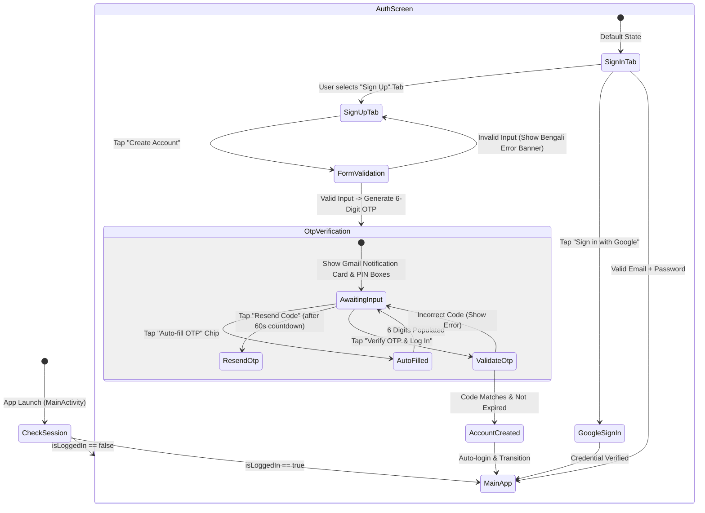
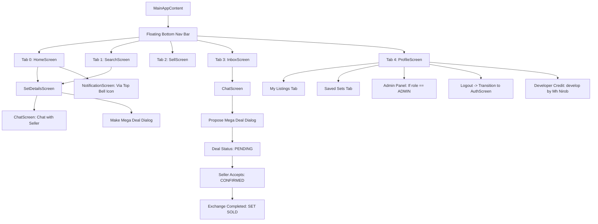

# USER FLOWS & STATE TRANSITION SPECIFICATION
## Application: Polytechnic Book Exchange (`BookSet`)

---

## 1. Top-Level Authentication & Entry Flow

---

## 2. Navigation & Core App Flow

---

## 3. Detailed Workflow Walkthroughs

### 3.1 Student Sign Up with Gmail OTP Verification
1. User opens app (if logged out) and selects "Sign Up" tab.
2. User enters Full Name, Gmail Address, Password (min 4 chars), Phone number, College, Technology (e.g. Computer), Semester (e.g. 3rd).
3. User taps "Create Account".
4. Validation verifies non-empty name, valid email regex, password length >= 4, and phone length >= 6.
5. System invokes `MarketplaceRepository.initiateSignUpWithOtp(...)`.
6. A cryptographic 6-digit code is created (e.g. `481923`), with a 5-minute expiry.
7. System fires Android system push notification and on-screen incoming Gmail simulation box.
8. Screen animates into **Gmail OTP Verification Card**:
   - Shows user's Gmail address with an "Edit" pencil icon.
   - Shows simulated inbox arrival banner with OTP code.
   - Shows 6 PIN boxes and focuses the numeric soft keyboard.
   - User can type 6 digits manually or tap "Auto-fill".
   - 60-second countdown runs; once at 0, "Resend OTP" button is enabled.
9. User taps "Verify OTP & Log In".
10. On match: Account is inserted into Room DB, marked as current session, welcome notification added, and app smoothly enters `HomeScreen`.

### 3.2 Publishing a Book Set (Senior Seller)
1. User taps center "+" (Sell) tab on the floating bottom navigation bar.
2. User enters:
   - Book Set Title (e.g. "3rd Semester Complete Computer Technology Book Set")
   - Department / Technology selection
   - Semester selection
   - Total Asking Price in BDT (৳)
   - Overall condition (Like New, Good, Used, Heavily Used)
   - Description and meetup campus
3. User adds included individual books:
   - Taps "Add Book"
   - Enters Book Subject Name, Edition, Condition
4. User selects cover photo (from preset engineering covers or camera/gallery).
5. User taps "Publish Listing".
6. Record is inserted into Room DB (`book_sets` and `included_books`).
7. User is automatically redirected to `HomeScreen` where their new listing appears at the top of the feed.

### 3.3 Discovering & Negotiating a Mega Deal (Junior Buyer)
1. Buyer opens `HomeScreen` or `SearchScreen`.
2. Filters by Technology (`Civil`) and Semester (`1st`).
3. Taps on a listing to open `SetDetailsScreen`.
4. Inspects itemized books, editions, and seller details.
5. Taps "Chat with Seller" to initiate a direct conversation.
6. A `ConversationEntity` is retrieved or created in Room DB.
7. Inside `ChatScreen`, buyer discusses details and taps "Make Deal".
8. Buyer inputs proposed price (e.g. ৳500) and meetup location ("FPI Shahid Minar").
9. Seller sees the in-chat deal card with "Accept" or "Decline".
10. Seller taps "Accept". Deal status updates to `CONFIRMED`.
11. After physical campus meeting, seller taps "Exchange Completed". Set status updates to `SOLD`.

### 3.4 Super Admin Moderation Flow
1. Super Admin logs in using `mdmaheraz65@gmail.com`.
2. Admin opens `ProfileScreen` and taps "Open Admin Panel".
3. System loads `AdminPanelScreen`:
   - Tab 1: Telemetry (Daily Active Users, Visits Today, Traffic Distribution FPI vs FCI).
   - Tab 2: Student Directory (Moderation actions: Suspend, Ban, Reactivate).
   - Tab 3: Listing Moderation (Remove spam listings, view seller contacts).
   - Dialogs: "Add Student" and "Add Listing" for manual administrative provisioning.
